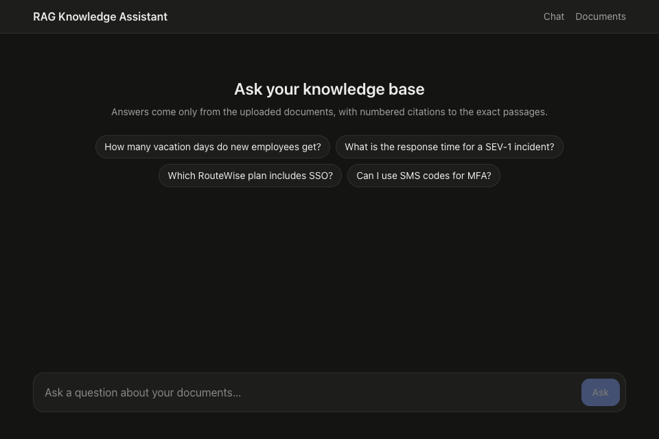
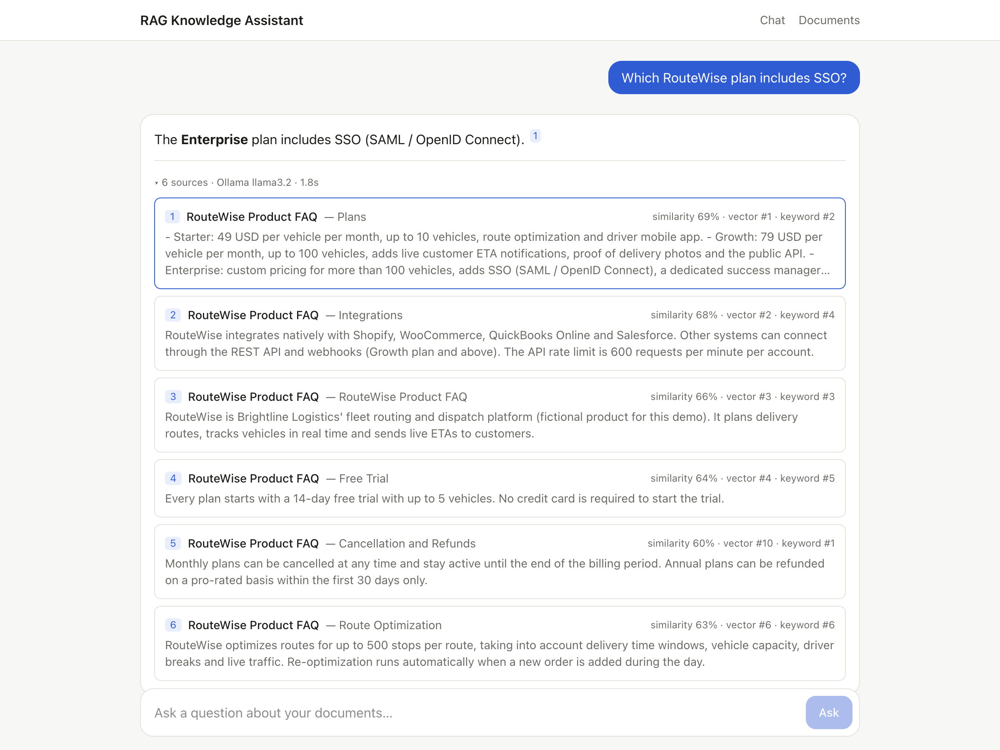
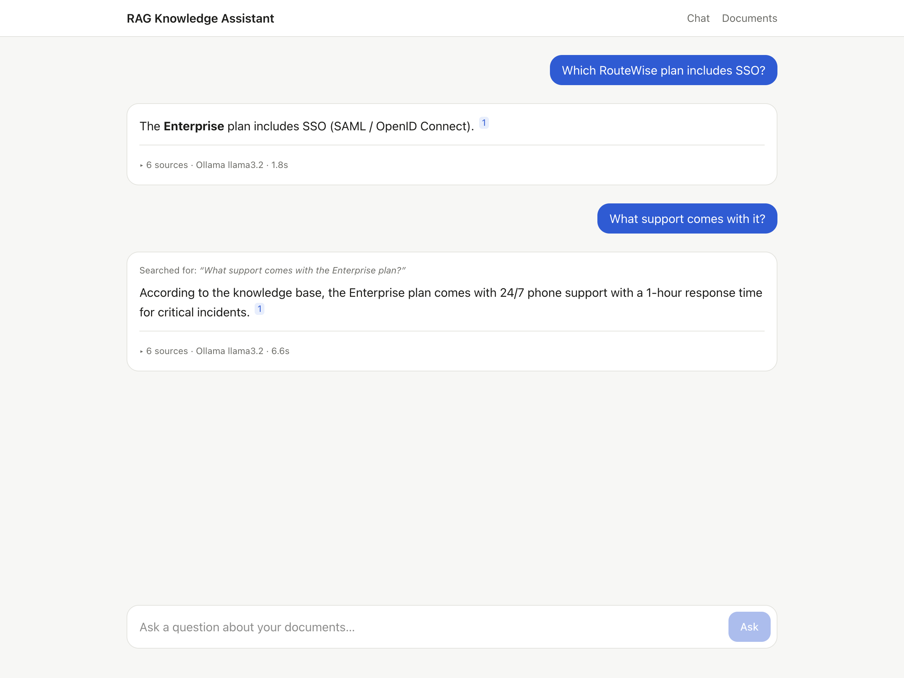
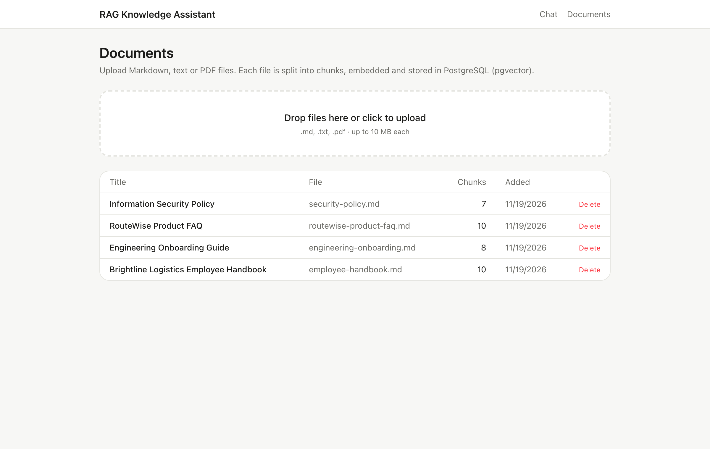

# RAG Knowledge Assistant

Ask questions about your documents and get grounded answers with numbered source citations.

**Live demo: [rag.metamaker.ca](https://rag.metamaker.ca)** (read-only sample knowledge base, OpenAI `gpt-4o-mini`, rate-limited).

Built with **Next.js 15, TypeScript, Node.js, PostgreSQL + pgvector** and **Ollama** (fully local) or **OpenAI** (one env variable). No LangChain or vector-DB SaaS: every step of the pipeline is plain, readable TypeScript and SQL.



<sub>Recorded with a local 3B model (Ollama `llama3.2`) on a laptop CPU; playback 2× faster.</sub>

## Features

- **Document ingestion**: Markdown, text and PDF upload; structure-aware chunking with overlap and heading context; idempotent re-ingestion via content hashing
- **Hybrid retrieval**: vector search (pgvector, HNSW index) + PostgreSQL full-text search in a single SQL query, merged with Reciprocal Rank Fusion
- **Follow-up questions**: the LLM rewrites a follow-up ("and after three years?") into a standalone search query using the chat history, with a deterministic fallback when a small model leaves it unchanged; the UI shows what was actually searched
- **Grounded answers**: the model answers only from retrieved passages, cites them as `[1]`, `[2]`, and says when the answer isn't in the knowledge base; retrieved text is treated as data (prompt-injection aware)
- **Streaming UI**: answers stream token by token; clickable citations highlight the source passage with similarity and per-search ranks
- **Provider-agnostic**: local Ollama models or OpenAI for chat and embeddings
- **Evals**: retrieval hit@k / MRR across vector, keyword and hybrid modes, plus answer accuracy

## Screenshots

| Answer with sources | Follow-up question | Documents |
|---|---|---|
|  |  |  |

## Architecture

```
Ingestion:  file → parse (unpdf) → chunk (headings + paragraphs, overlap) → embed → Postgres (chunks + tsvector)
Query:      question → rewrite follow-up (if any) → embed → hybrid search (vector + full-text, RRF) → grounded prompt → streamed answer + sources
```

| Path | Purpose |
|---|---|
| `src/lib/parse.ts` | File → clean text (PDF via unpdf) |
| `src/lib/chunker.ts` | Markdown-aware recursive chunking with overlap |
| `src/lib/embeddings.ts` | Ollama / OpenAI embeddings, batching, task prefixes |
| `src/lib/ingest.ts` | Ingestion pipeline with transaction and deduplication |
| `src/lib/rewrite.ts` | Follow-up → standalone query (condense question) |
| `src/lib/retrieve.ts` | Hybrid search with Reciprocal Rank Fusion in SQL |
| `src/lib/prompt.ts` | Grounded prompt with citation rules |
| `src/lib/llm.ts` | Streaming chat for Ollama (NDJSON) and OpenAI (SSE) |
| `src/app/api/*` | Chat (NDJSON event stream) and document endpoints |
| `scripts/eval.ts` | Retrieval and answer evaluation |

## Design decisions

- **Postgres + pgvector instead of a separate vector database.** Documents, chunks, vectors and the full-text index live in one database: one transaction per ingested file, cascading deletes, and room for row-level security later. A dedicated vector DB makes sense at much larger scale.
- **Hybrid search with RRF.** Embeddings understand meaning but miss exact terms (product names, codes); full-text search is the opposite. Reciprocal Rank Fusion merges the two rankings without having to normalise their scores, and it is all one SQL query.
- **Chunks keep their heading path** ("Handbook > Time Off > Vacation"), which is embedded with the text and shown in the UI, so short passages keep their context.
- **History is used only for query rewriting.** The answer prompt gets the standalone question instead of old turns: fewer tokens, and in testing the small model stopped refusing questions it could answer.
- **Measure before tuning.** Every change (chunking, prompt, rewriting) was checked against the eval sets below.

## Quick start

Requirements: Node.js 20.12+, Docker, [Ollama](https://ollama.com).

```bash
ollama pull llama3.2 && ollama pull nomic-embed-text
cp .env.example .env
npm install
npm run db:up        # Postgres 17 + pgvector on port 5433
npm run db:migrate
npm run ingest -- ./sample-docs
npm run dev          # http://localhost:3000
```

Production build: `npm run build && npm start`.

CLI: `npm run ask -- "How many vacation days do new employees get?"` · inspect how a file is parsed and chunked: `npm run inspect -- ./file.pdf`

To use OpenAI, set `LLM_PROVIDER=openai`, `EMBEDDING_PROVIDER=openai` and `OPENAI_API_KEY` in `.env`, then re-ingest.

## Public demo deployment

The repo includes a production setup for a public, read-only demo: `Dockerfile`, `docker-compose.prod.yml` (app + its own Postgres/pgvector, app bound to `127.0.0.1`), `.env.production.example` and an nginx site template in `deploy/`.

Demo protection is configured with environment variables: `DEMO_MODE=true` (no uploads or deletes), `RATE_LIMIT_PER_IP` (questions per IP per hour), `DAILY_QUESTION_LIMIT` (site-wide daily cap), plus `limit_req` in nginx. Provider errors are shown to visitors as short messages; details stay in server logs.

```bash
cp .env.production.example .env.production   # fill in POSTGRES_PASSWORD and OPENAI_API_KEY
docker compose -f docker-compose.prod.yml --env-file .env.production up -d --build
docker compose -f docker-compose.prod.yml --env-file .env.production run --rm app npm run db:migrate
docker compose -f docker-compose.prod.yml --env-file .env.production run --rm app npm run ingest -- ./sample-docs
```

## Evaluation

16 questions over the sample knowledge base (`eval/questions.json`):

| Retrieval mode | hit@1 | hit@3 | MRR |
|---|---|---|---|
| Vector only | 94% | 100% | 0.97 |
| Keyword only | 94% | 100% | 0.97 |
| **Hybrid (RRF)** | **100%** | 100% | **1.00** |

Answer accuracy (generated answer contains the expected fact): **16/16** with local Ollama `llama3.2` and hybrid retrieval.

Follow-up questions (`eval/followups.json`: 10 conversations, one of them a topic switch), hybrid search with three ways to build the search query:

| Query strategy | hit@1 | hit@3 | MRR |
|---|---|---|---|
| Follow-up as typed | 30% | 80% | 0.55 |
| Previous question + follow-up | 90% | 90% | 0.92 |
| **LLM rewrite + fallback** | **90%** | **100%** | **0.95** |

Follow-up answer accuracy: **10/10** with local `llama3.2`. Chat history is used only for rewriting: passing it into the answer prompt made the small model refuse even when the right passage was retrieved (7/10).

Same evals on the live deployment (OpenAI `gpt-4o-mini` + `text-embedding-3-small` at 768 dimensions): hybrid retrieval 100% hit@1 / MRR 1.00, answers **16/16**; follow-ups with LLM rewrite 100% hit@1 / MRR 1.00 (follow-up as typed: 50% / 0.63), answers **10/10**. The stronger model rewrites every follow-up itself, so the fallback is not needed there.

Run: `npm run eval` or `npm run eval -- --followups` (add `--answers` to also check generated answers).

The sample documents describe a fictional company (Brightline Logistics) created for this demo.

## Roadmap

Cross-encoder reranking · Claude provider · multi-tenant access control with SSO (Keycloak / Entra ID) and Postgres RLS · DOCX/HTML/URL sources · observability (Langfuse) · deployment templates.

## License

MIT
